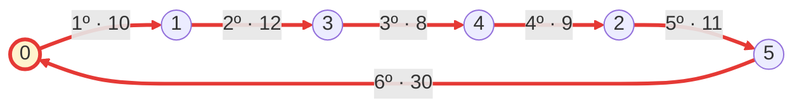

## 🧪 Ejemplo de ejecución

Para la siguiente matriz de distancias entre 6 ciudades (`0` a `5`), partiendo de la ciudad `0`:

```text
     0   1   2   3   4   5
0    0  10  15  20  25  30
1   10   0  35  12  28  40
2   15  35   0  30   9  11
3   20  12  30   0   8  22
4   25  28   9   8   0  18
5   30  40  11  22  18   0
```

Los números de la primera fila y de la primera columna identifican las ciudades; no forman parte de la matriz.

El programa debería imprimir:

```text
Ruta: 0 -> 1 -> 3 -> 4 -> 2 -> 5 -> 0
Distancia total: 80
```

En cada paso se comparan únicamente las ciudades que todavía no se han visitado:

| Paso | Ciudad actual | Distancias a ciudades no visitadas | Elección |
|---|---|---|---|
| 1 | `0` | `1`: 10, `2`: 15, `3`: 20, `4`: 25, `5`: 30 | Ciudad `1`, distancia 10 |
| 2 | `1` | `2`: 35, `3`: 12, `4`: 28, `5`: 40 | Ciudad `3`, distancia 12 |
| 3 | `3` | `2`: 30, `4`: 8, `5`: 22 | Ciudad `4`, distancia 8 |
| 4 | `4` | `2`: 9, `5`: 18 | Ciudad `2`, distancia 9 |
| 5 | `2` | `5`: 11 | Ciudad `5`, distancia 11 |
| 6 | `5` | Todas las ciudades ya fueron visitadas. | Regresar a `0`, distancia 30 |

La distancia total es:

```text
10 + 12 + 8 + 9 + 11 + 30 = 80
```

Aunque desde la ciudad `4` la ciudad `3` está más cerca que la `2`, no se puede elegir porque **ya fue visitada**. El regreso a la ciudad inicial se realiza únicamente después de visitar todas las demás.

## 🗺️ Mapa del recorrido



- 🔴 **Flechas rojas:** la ruta construida por la heurística, numerada según el orden del recorrido y con la distancia de cada tramo.
- 🟡 **Nodo con relleno amarillo:** la ciudad de partida, a la que se regresa al final.
- Para facilitar la lectura, el mapa muestra únicamente las conexiones utilizadas. Las demás distancias aparecen en la matriz.