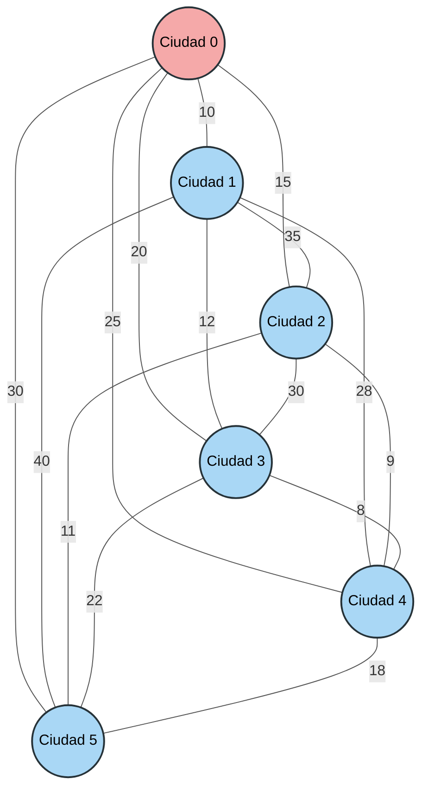

## 🧪 Ejemplo de ejecución

Para la siguiente matriz de distancias entre 6 ciudades (`0` a `5`), partiendo de la ciudad `0`:

```text
     0   1   2   3   4   5
0    0  10  15  20  25  30
1   10   0  35  12  28  40
2   15  35   0  30   9  11
3   20  12  30   0   8  22
4   25  28   9   8   0  18
5   30  40  11  22  18   0
```

Los números de la primera fila y de la primera columna identifican las ciudades; no forman parte de la matriz.

El programa debería imprimir:

```text
Ruta: 0 -> 1 -> 3 -> 4 -> 2 -> 5 -> 0
Distancia total: 80
```

## 🗺️ Mapa de ciudades



- 🔴 **Ciudad roja:** punto de partida y regreso.
- 🔵 **Ciudades azules:** las demás ciudades que deben visitarse.
- **Líneas sin flechas:** conexiones que pueden recorrerse en ambos sentidos.
- **Número sobre cada conexión:** distancia entre las dos ciudades.

⬅️ [Volver al índice](..)
