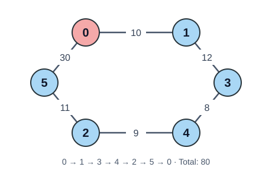

# 🧳 Viajante por Vecino Más Cercano

🟡 **Dificultad:** Intermedia · 🧠 **Técnica:** Heurística voraz · 📐 **Representación:** Matriz de distancias

## 📝 Enunciado

Un viajante debe visitar todas las ciudades exactamente una vez y regresar a la ciudad de partida.

Dada una matriz de distancias entre `n` ciudades y una ciudad inicial, implementa una función que construya una ruta procurando **minimizar la distancia total recorrida**.

Debes identificar y justificar el **criterio voraz** correspondiente al método de vecino más cercano.

## 🧪 Ejemplo de ejecución

Para la siguiente matriz de distancias entre 6 ciudades (`0` a `5`), partiendo de la ciudad `0`:

```text
     0   1   2   3   4   5
0    0  10  15  20  25  30
1   10   0  35  12  28  40
2   15  35   0  30   9  11
3   20  12  30   0   8  22
4   25  28   9   8   0  18
5   30  40  11  22  18   0
```

Los números de la primera fila y de la primera columna identifican las ciudades; no forman parte de la matriz.

El programa debería imprimir:

```text
Ruta: 0 -> 1 -> 3 -> 4 -> 2 -> 5 -> 0
Distancia total: 80
```
## 🗺️ Mapa del recorrido



El nodo rojo indica la ciudad inicial. <br> 
Los números sobre las conexiones representan las distancias. <br> 
Se muestran únicamente las conexiones del recorrido; la matriz contiene todas las distancias.

## 🚧 Restricciones y suposiciones

- Debes **identificar y justificar el criterio voraz** utilizado.
- La matriz tiene tamaño `n × n`, con `n ≥ 2`.
- Las ciudades se identifican con índices de `0` a `n - 1`.
- La ciudad inicial debe pertenecer al conjunto de ciudades.
- Existe una conexión directa entre cualquier par de ciudades.
- La matriz es **simétrica**: la distancia de `i` a `j` es igual a la de `j` a `i`.
- La distancia de una ciudad a sí misma es `0`; las demás distancias son enteros **positivos**.
- Cada ciudad debe aparecer exactamente una vez en la ruta, excepto la inicial, que también aparece al final para cerrar el recorrido.
- Si dos ciudades candidatas están a la misma distancia, se debe elegir la de **menor índice**.
- La distancia total debe incluir el regreso a la ciudad inicial.
- No se permite utilizar fuerza bruta, backtracking ni programación dinámica.

## ✍️ Para analizar

- Explica el criterio voraz elegido.
- Analiza la complejidad temporal y espacial de tu implementación.
- ¿Cambiar la ciudad inicial puede modificar la distancia total obtenida?
- Determina si el criterio garantiza encontrar la ruta más corta para cualquier matriz que cumpla las suposiciones. Justifica tu respuesta.

⬅️ [Volver al índice](..)
