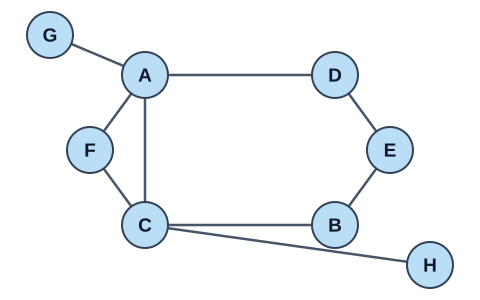
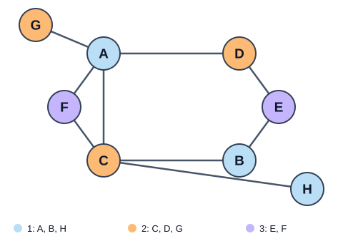

# 🎨 Coloreo de Grafos

🟡 **Dificultad:** Intermedia · 🧠 **Técnica:** Heurística voraz · 📐 **Representación:** Matriz de adyacencia

## 📝 Enunciado

Dado un grafo no dirigido, implementa una función que asigne un color a cada vértice, procurando utilizar la **menor cantidad de colores**.

Dos vértices unidos por una arista deben tener **colores distintos**.

Debes identificar y aplicar un **criterio voraz** para construir el coloreo.

## 🧪 Ejemplo de ejecución

Para el siguiente grafo de `8` vértices, identificados de `A` a `H`:

```text
     A B C D E F G H
A    0 0 1 1 0 1 1 0
B    0 0 1 0 1 0 0 0
C    1 1 0 0 0 1 0 1
D    1 0 0 0 1 0 0 0
E    0 1 0 1 0 0 0 0
F    1 0 1 0 0 0 0 0
G    1 0 0 0 0 0 0 0
H    0 0 1 0 0 0 0 0
```

Los identificadores de la primera fila y de la primera columna no forman parte de la matriz. Un `1` indica que existe una arista entre los dos vértices; un `0` indica que no existe.

| Vértice | A | B | C | D | E | F | G | H |
|---|---|---|---|---|---|---|---|---|
| Cantidad de vecinos | 4 | 2 | 4 | 2 | 2 | 2 | 1 | 1 |

## 🗺️ Mapa del grafo



Una salida del procedimiento voraz es:

```text
Vertice: A B C D E F G H
Color:   1 1 2 2 3 3 2 1

Cantidad de colores utilizados: 3
```

## 🎨 Coloreo obtenido



## 🚧 Restricciones y suposiciones

- Se debe **identificar y justificar el criterio voraz** utilizado.
- El grafo se representa mediante una **matriz de adyacencia** de tamaño `n × n`, con `n ≥ 1`.
- El grafo es **no dirigido**: su matriz de adyacencia es simétrica.
- No existen aristas de un vértice hacia sí mismo: la diagonal de la matriz contiene únicamente ceros.
- Los valores de la matriz son exclusivamente `0` y `1`.
- Cada vértice debe recibir **exactamente un color**.
- Dos vértices unidos por una arista no pueden recibir el mismo color.
- Los colores se identifican mediante enteros positivos.
- Se permite reutilizar un color en distintos vértices siempre que se respete la condición de adyacencia.
- Si dos vértices tienen la misma prioridad según tu criterio, se debe elegir primero el de **menor identificador en orden alfabético**.
- Los resultados deben mostrarse en el **orden original de los vértices**, independientemente del orden de procesamiento.
- El procedimiento debe funcionar también para grafos con vértices aislados o con varias componentes conexas.
- No se permite utilizar fuerza bruta, backtracking ni programación dinámica.

⬅️ [Volver al índice](..)